<p align="center">
  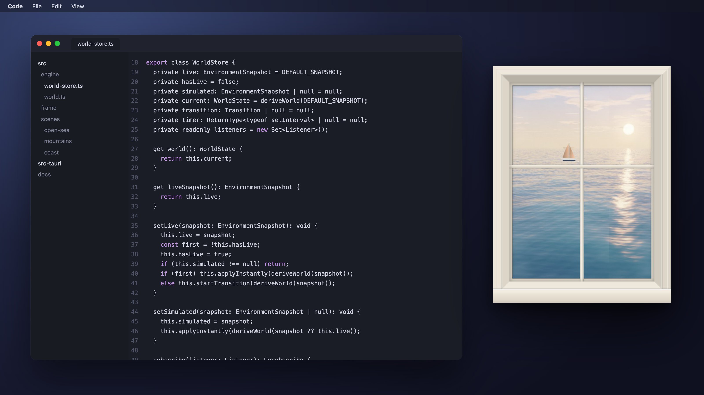
</p>

<h1 align="center">Virtual Window</h1>

<p align="center">
  <strong>A real window for your desktop.</strong><br>
  A floating pane that opens onto a living 3D landscape, lit by the real sun and moon where you are, with your actual weather outside.
</p>

<p align="center">
  <a href="LICENSE-MIT"></a>
  
  
  
</p>

<p align="center">
  <a href="#download">Download</a> ·
  <a href="#scenes">Scenes</a> ·
  <a href="#build-from-source">Build from source</a> ·
  <a href="docs/scene-api.md">Create a scene</a> ·
  <a href="PRIVACY.md">Privacy</a>
</p>

---

Virtual Window is not a video playing in a frame. Every scene is rendered in real time from the sky down: the sun and the moon sit where they really are for your location, clouds form and drift with the actual wind, rain beads on the glass, and the view shifts as you move, the way the world behind a real window does.

No accounts, no settings to fill in, no buttons on screen. Put it next to your editor or browser and forget it is software.

<table>
  <tr>
    <td align="center" width="33%"></td>
    <td align="center" width="33%">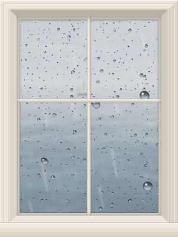</td>
    <td align="center" width="33%">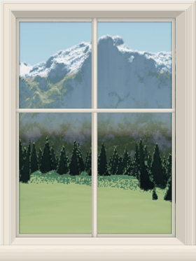</td>
  </tr>
  <tr>
    <td align="center"><b>Alive</b><br><sub>Waves, light and clouds are rendered live, never looped.</sub></td>
    <td align="center"><b>Real glass</b><br><sub>Raindrops bead, slide and refract the view behind them.</sub></td>
    <td align="center"><b>Real depth</b><br><sub>The cursor stands in for your head: far things follow you, near things stay.</sub></td>
  </tr>
</table>

## Highlights

- **A real sky.** Sun and moon positions are computed astronomically for your location every minute, moon phase included. Dawn, golden hour, twilight and moonlit nights happen when they happen, in both hemispheres, the tropics and the polar regions.
- **Your weather.** Live conditions from Open-Meteo: clouds and their shadows sweeping over the land, overcast skies, fog, rain, snow and storms. Wind drives the clouds, the waves and the rain on the glass.
- **Physically based light.** Rayleigh and Mie atmospheric scattering, aerial perspective, soft shadows, Fresnel reflections on water and glass, alpenglow on the peaks.
- **Real depth.** Rays are traced through the fixed plane of the window from an eye that follows the cursor, so ridges hide and reveal what is behind them. An architectural frame with an inner bevel, mullions and a reflective pane completes the illusion.
- **Calm by design.** Weather changes blend in over a minute and a half and scenes crossfade. Nothing jumps, flashes or asks for attention.
- **Light on resources.** Expensive terrain is cached and only recomputed when something changes, the frame rate is capped at 30 FPS, resolution adapts to your machine, and everything pauses when the window is hidden.

## Scenes

<table>
  <tr>
    <td align="center">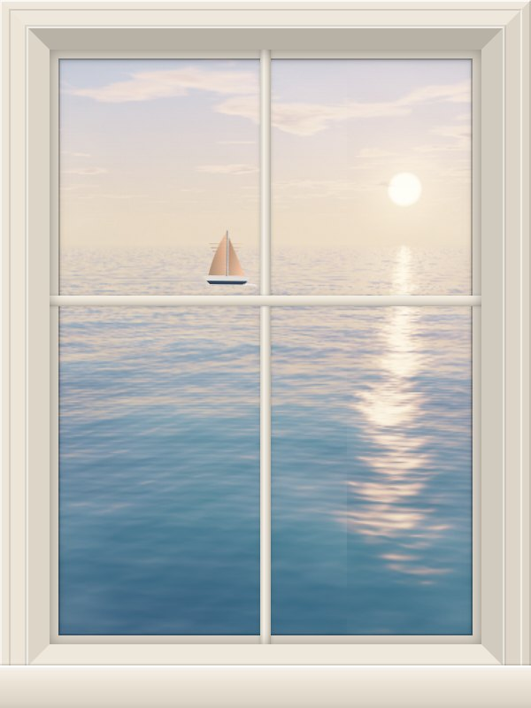<br><b>Open sea</b></td>
    <td align="center">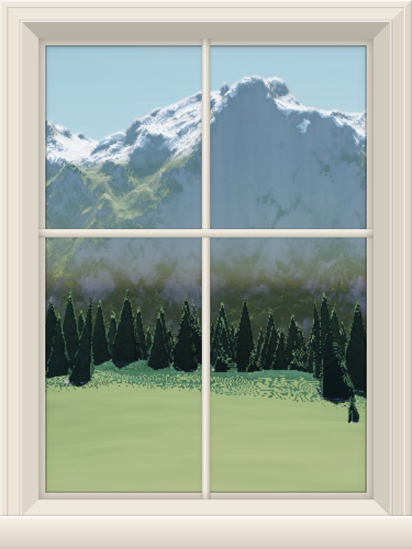<br><b>Mountains</b></td>
    <td align="center">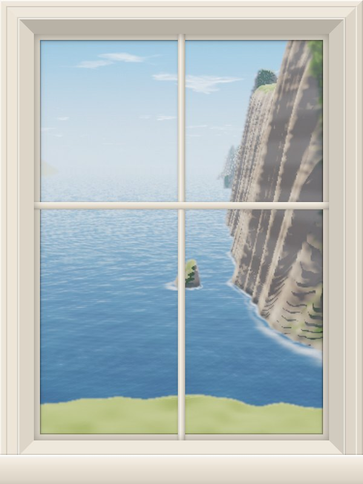<br><b>Coast</b></td>
    <td align="center">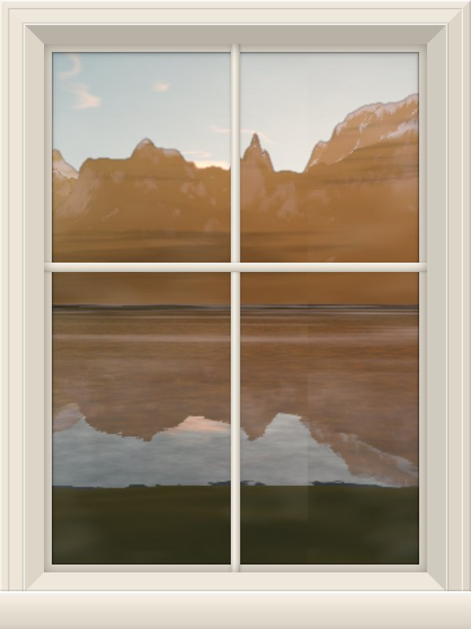<br><b>Alpine lake</b></td>
  </tr>
  <tr>
    <td align="center">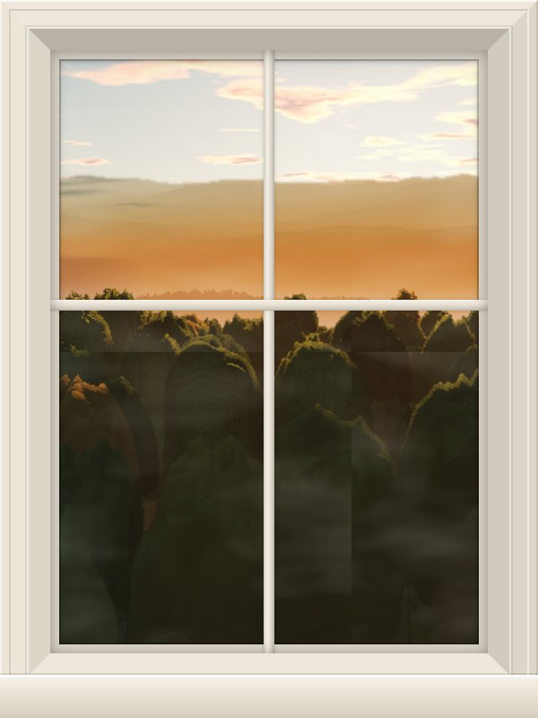<br><b>Forest</b></td>
    <td align="center">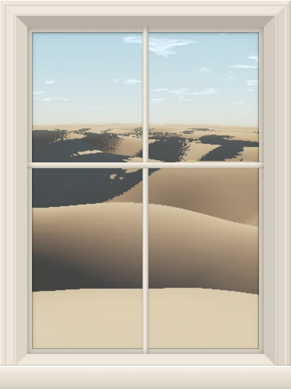<br><b>Dunes</b></td>
    <td align="center">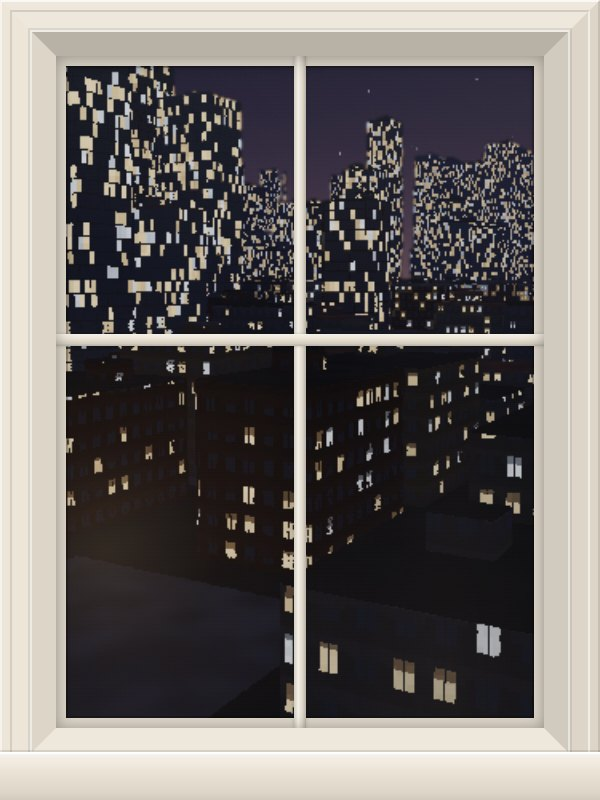<br><b>City</b></td>
    <td align="center"><a href="docs/scene-api.md"><b>Your scene</b></a><br><sub>Scenes are plug and play.<br>See the scene API.</sub></td>
  </tr>
</table>

### Time and weather

The same coast through a day and a few kinds of weather. None of this is prerecorded: it is the live world state rendered by the scene.

<p align="center">
  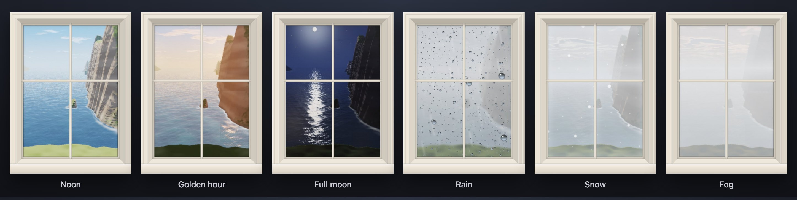
</p>

### Make it yours

Three frame styles in six colors, adjustable brightness, focus mode with fewer stimuli, reduce motion and always on top. The window remembers where you left it and at what size.

<p align="center">
  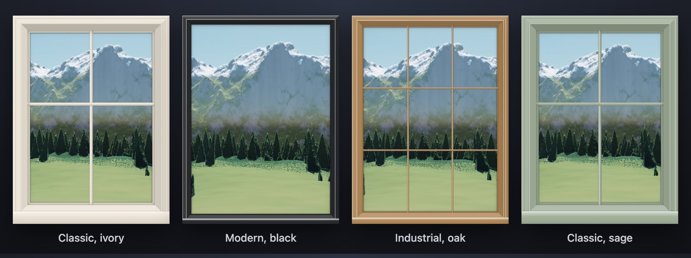
</p>

## Download

Get the installer for your system from the [Releases](../../releases) page.

The builds are not code-signed yet:

| System | First launch |
|---|---|
| macOS | Right-click the app and choose **Open**. |
| Windows | If SmartScreen appears, click **More info**, then **Run anyway**. |
| Linux | Use the `.AppImage` or `.deb`. On Wayland, parallax only reacts while the cursor is over the window, and "always on top" depends on your compositor. |

## Usage

Drag anywhere to move the window and resize it from its edges. Everything else lives in the right-click menu, and every choice is remembered:

| Menu | Options |
|---|---|
| Scene | Open sea, Mountains, Coast, Alpine lake, Forest, Dunes, City |
| Frame | Classic, Modern or Industrial, in Ivory, White, Oak, Walnut, Black or Sage |
| Brightness | 100% to 40% |
| Focus mode | Hides small moving details and softens motion |
| Reduce motion | Stops continuous animation; light and weather still change |
| Always on top | Keeps the window above other apps |

## How it works

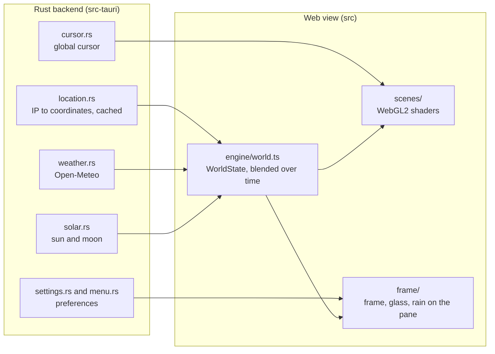

- All network access happens in Rust over HTTPS. The web view has no network access and runs under a strict Content Security Policy.
- Scenes are bundled at build time, never downloaded. Each one receives the world state (sun, moon, weather, wind, palette) and renders it; the frame and the glass are shared.
- Realistic scenes share a GLSL library for atmosphere, clouds, ocean and terrain, and a two-pass pipeline: an expensive cached pass for terrain and lighting, and a cheap per-frame pass for what moves.

## Privacy

To show your sky and weather, the app looks up your approximate location from your IP address (ipapi.co, with ipwho.is as a fallback) and requests the weather for it from Open-Meteo. Coordinates are rounded to about 1 km and cached locally for 12 hours. There are no accounts, no analytics and no telemetry. Details in [PRIVACY.md](PRIVACY.md).

## Build from source

Requirements: Node.js 20+, Rust stable and the [Tauri prerequisites](https://tauri.app/start/prerequisites/) for your system.

```bash
npm install
npm run tauri dev     # desktop app with hot reload
npm run tauri build   # installers in src-tauri/target/release/bundle/
```

To design scenes you don't need Rust at all: run `npm run dev` and open http://localhost:1420 in a browser. A built-in simulator (`Ctrl/Cmd + Shift + D` in the desktop app) lets you try any hour, moon phase, weather, frame and window size.

| Command | What it does |
|---|---|
| `npm run check` | Type checks and runs the frontend tests, including strict parsing of every shader |
| `npm run capture` | Renders every scene in several conditions into `.captures/` for visual review |
| `npm run capture -- --save-baseline` | Saves a reference; later runs produce before and after comparisons |
| `npm run media` | Regenerates the images in this README |

Rust checks live in `src-tauri`: `cargo fmt --check`, `cargo clippy --all-targets -- -D warnings` and `cargo test`. CI runs the Rust checks on macOS, Windows and Linux, and the frontend checks on Linux.

## Create a scene

A scene is a folder in `src/scenes/` with a manifest and either HTML and CSS or a fragment shader. The engine hands it the world as CSS variables or uniforms, so a scene never has to know about locations, APIs or astronomy. Start with the [scene API](docs/scene-api.md) and the template in `src/scenes/_template`.

## Contributing

Contributions are welcome, especially new scenes. Read [CONTRIBUTING.md](CONTRIBUTING.md) to get started. To report a vulnerability, see [SECURITY.md](SECURITY.md).

## Acknowledgements

- Weather data by [Open-Meteo.com](https://open-meteo.com/), licensed under [CC BY 4.0](https://creativecommons.org/licenses/by/4.0/).
- Built with [Tauri](https://tauri.app/).
- The rendering techniques owe a lot to the articles of [Inigo Quilez](https://iquilezles.org/articles/) on terrain raymarching and noise derivatives. All shader code in this repository is original.

## License

Licensed under either of [Apache License 2.0](LICENSE-APACHE) or [MIT license](LICENSE-MIT), at your option.

Unless you explicitly state otherwise, any contribution intentionally submitted for inclusion in this project by you, as defined in the Apache-2.0 license, shall be dual licensed as above, without any additional terms or conditions.

Open-Meteo's free API is for non-commercial use; commercial redistributions need their own plan.
